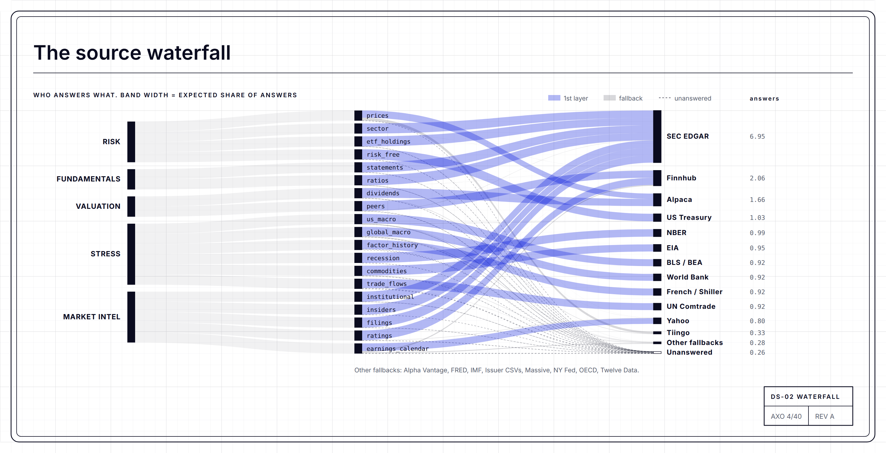
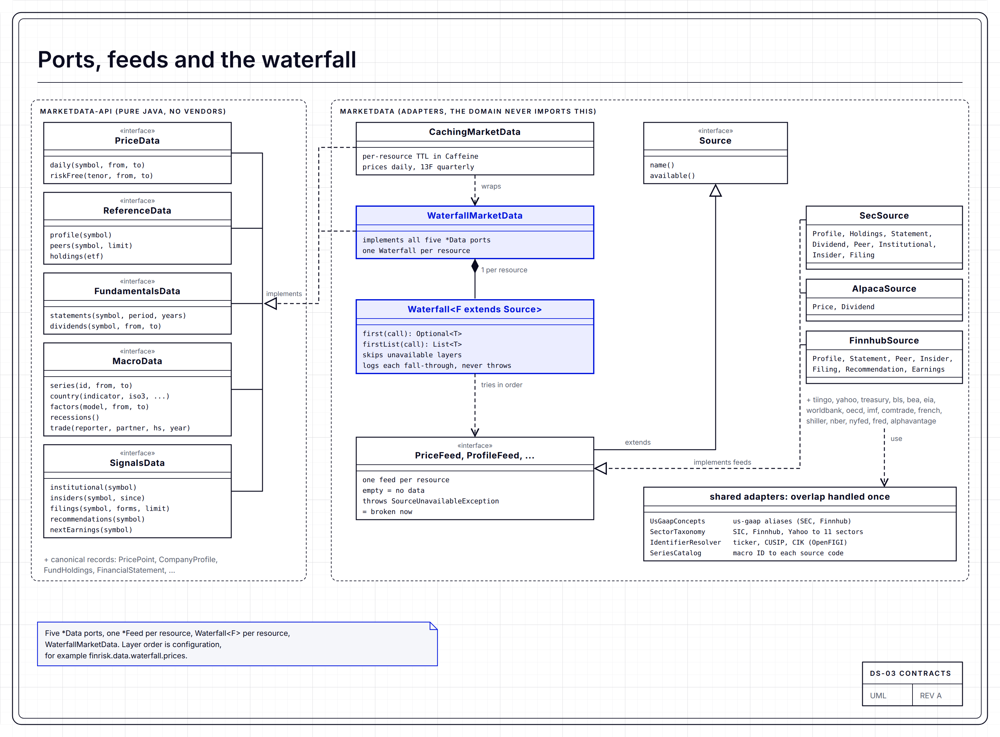
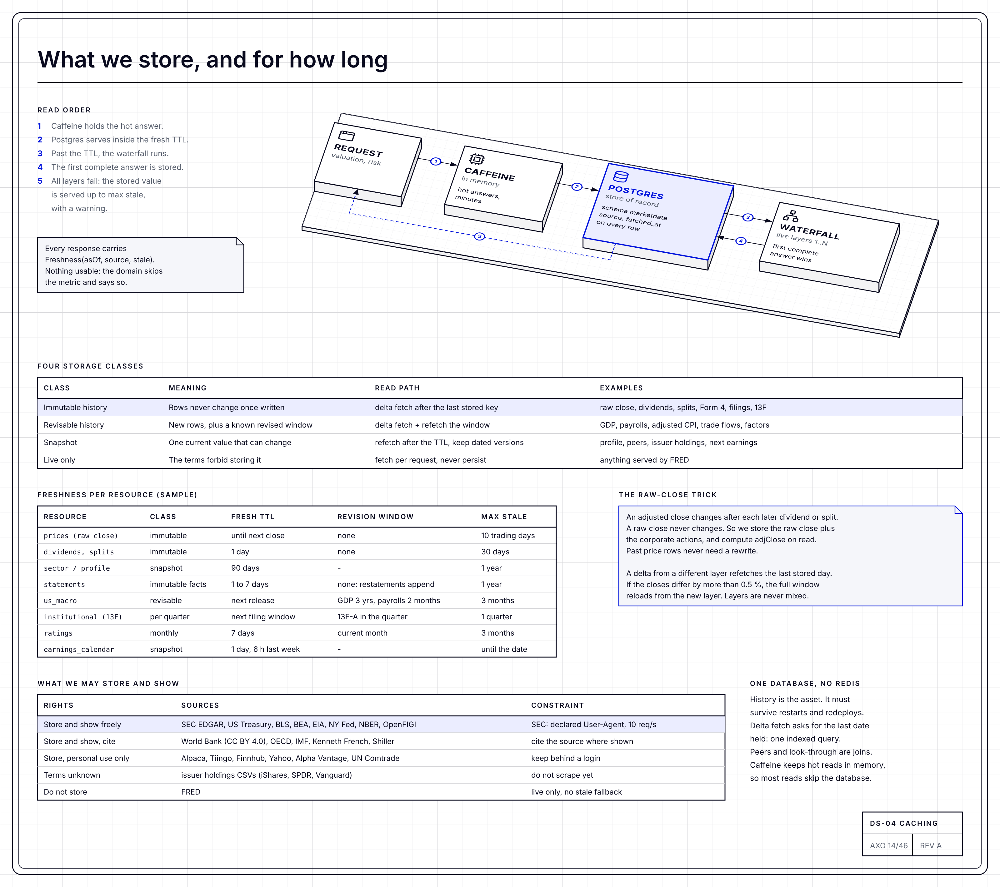

  
  
  
  
  

  
  
  
  
  
  
  

  
  
  
  

## What this is

I built FinRisk for people with a low risk tolerance, and for myself. If a big drop would hurt you, you cannot afford a portfolio where everything falls together, so overlapping holdings and correlated assets are the problem I care about most. Many people think they are diversified because they own ten funds, when three of them hold the same stocks. I wanted to see how much risk my portfolio really carries, and to compare that with how much I am comfortable taking.

You enter your accounts and trades. It then looks at the portfolio in five ways: risk, fundamentals, valuation, stress tests and market intelligence. So you can ask how concentrated you are, how much your holdings overlap and move together, what your ETFs really hold, what a stock is worth, and what a recession would do to you. It gives analysis, not investment advice.

There is only one kind of user, the investor. Your accounts, trades and holdings are private to you. Market data is shared by everyone and stored once, because there is no reason to fetch the same closing price twice. The landing page is live at [finance-kit-bay.vercel.app](https://finance-kit-bay.vercel.app/).

## What I wanted to practice

The risk questions come first, but this is also a personal project with no money behind it, so almost every decision here is a way of working inside a limit. Free data tiers cap how much I can fetch, and a free database caps how much I can store. I treated those caps as the design problem instead of a nuisance.

- Pulling data from many free sources and deciding, per kind of data, which one to ask first.
- Spending little: 25 calls a day on one source, 500 symbols a month on another, 200k database operations a month.
- Deciding what to cache, what to store, and how stale something may get before I stop trusting it.
- Keeping each user's portfolio private while sharing market data across everyone, with role-based access.
- Keeping the finance code from knowing which vendor supplied a number.
- Using real finance: DCF, dividend discount, Peter Lynch fair value, peer multiples, beta, alpha, drawdown, ETF look-through.
- Clean Java: layers, plain JDBC, validation, paging and rate limiting.
- Reading each source's terms and keeping to them. FRED forbids storing its data, so I never store it.

I left some ideas out on purpose. Geopolitical signals, analyst price targets, growth estimates, supply-chain links and news sentiment all lacked a decent free source, or another signal already answered the question. I would rather ship five lenses that work than eight that lean on shaky data.

## Picking data sources

I started from a list of candidates and graded each one on how deep its history goes, how much it lets me fetch, what it costs and what its terms allow. Then I asked what each source can supply, and where.

Think of it as a small linear program. Each source is a yes or no. Its cost is the free tier, so every row costs nothing or is out. Its limits are the rate, volume, history and terms columns, and its supply is the dots on the right. I wanted every kind of data covered by a first choice and a backup, for no money, with the fewest calls and the least risk of a source breaking. The blue dots are my answer: dark blue is first choice, lighter blue is second, lightest is third.

Caching changed how I judged things. I pull the full history once and then only fetch what is new, so a tight daily quota matters less than how deep the history goes and whether the terms let me keep the data. An A grade means official, free, deep and cacheable. An F means I cannot use it.

A few limits still bite. Tiingo's 500 symbols a month caps my price universe. Alpha Vantage's 25 calls a day makes it a slow backfill at best. FRED cannot be stored at all. And SEC's ETF holdings arrive about 60 days late. The full research, with a note on how I checked each fact, is in [`docs/data-sources/inventory.md`](docs/data-sources/inventory.md).

## The waterfall

For each kind of data I try the sources in order until one answers. The diagram shows who ends up answering what. A wider band means that source answers more often. SEC EDGAR does the most work because it covers fundamentals, filings, insiders, institutions and ETF holdings. Everything the other sources do is smaller.

I did not order the sources by gut feeling. If you must try sources one after another, the cheapest order is highest chance of success divided by cost first (Smith's rule). I estimate the chance from the source's grade and how fully it covers that data, and the cost from its quota pressure, plus a penalty for FRED because every FRED read has to go live. A small script, [`waterfall.py`](docs/data-sources/waterfall.py), computes the order and writes it to [`waterfall.md`](docs/data-sources/waterfall.md). The order lives in configuration, so changing a score never needs a Java change.

Two rules keep the answers consistent. A source's answer only counts if every required field is present, and if it is not, the next source runs. And one answer always comes from one source. I never stitch fields from two vendors together, because that is how you end up with a price and a date that disagree.

The finance code only sees five ports: prices, reference data, fundamentals, macro and signals. Each source implements small feed interfaces for what it can serve, and a `Waterfall` holds the ordered sources for one kind of data. It skips any source that is down, logs the fall-through and never throws.

Several sources describe the same thing in their own words, so I wrote the translation once. One adapter maps us-gaap concept names for SEC and Finnhub. Another maps three sector schemes onto a single list of eleven sectors. A third maps tickers to CUSIPs and CIKs, and a fourth maps a macro series to each source's own code. The field-by-field mapping is in [`docs/data-sources/contracts.md`](docs/data-sources/contracts.md).

## Caching and storage

Most financial data never expires. It only grows. The close for a past day, or a filed 10-K, will not change, so I keep it and ask only for what is new.

Reading goes in a fixed order. Caffeine, an in-memory cache, holds the hot answers for a few minutes. Postgres serves anything still fresh. When a value is too old, the waterfall runs and the first complete answer gets stored. If every source fails, I serve the stored value anyway, with a warning, as long as it is not too old. Every response says when it was fetched, where it came from and whether it is stale.

Not all data ages the same way, so I sorted it into four kinds:

| Kind | What it means | How I keep it fresh | Examples |
|---|---|---|---|
| Immutable | Rows never change once written | fetch only what is after the last row | raw closes, dividends, splits, Form 4, filings, 13F |
| Revisable | New rows arrive and a recent window gets revised | fetch new rows and refetch the window | GDP, payrolls, adjusted CPI, trade flows |
| Snapshot | One current value that can change | refetch after a time limit, keep old versions | company profile, peers, next earnings date |
| Live only | The terms forbid storing it | fetch on every request | anything from FRED |

Every resource gets three ages. The fresh limit is how long I serve it without asking anyone. The revision window is the recent slice I refetch because the source may have corrected it. The max stale age is how old a value can get before I stop serving it even as a fallback. A few examples:

| Data | Kind | Fresh for | Refetch window | Max stale |
|---|---|---|---|---|
| Raw close | immutable | until the next close | none | 10 trading days |
| Profile and sector | snapshot | 90 days | none | 1 year |
| Statements | immutable | 1 to 7 days | none, restatements append | 1 year |
| US macro | revisable | until the next release | GDP 3 years, payrolls 2 months | 3 months |
| 13F holders | immutable | until the next filing window | amendments in the quarter | 1 quarter |
| Ratings | immutable | 7 days | current month | 3 months |

Prices need one trick. An adjusted close changes every time a later dividend or split happens, which would force me to rewrite history. A raw close never changes. So I store the raw close plus the dividends and splits, and work out the adjusted close when I read. When new rows come from a different source than the old ones, I compare the last day we both have. If the closes differ by more than half a percent, I reload that whole window from the new source instead of mixing them.

What I am allowed to keep depends on each source's terms:

| Rights | Sources | Rule |
|---|---|---|
| Store and show freely | SEC EDGAR, US Treasury, BLS, BEA, EIA, NY Fed, NBER, OpenFIGI | SEC wants a User-Agent and at most 10 requests a second |
| Store and show, with credit | World Bank, OECD, IMF, Kenneth French, Shiller | cite the source where it is shown |
| Store for personal use | Alpaca, Tiingo, Finnhub, Yahoo, Alpha Vantage, UN Comtrade | keep behind a login |
| Terms unknown | iShares, SPDR and Vanguard holdings files | do not scrape yet |
| Do not store | FRED | live only, no stale fallback |

Every stored row records its source. If a vendor changes its terms, I can delete just its rows.

I chose Postgres as the store of record, in its own `marketdata` schema. The history is the expensive part to rebuild, and it has to survive restarts and redeploys. Fetching only what is new needs one indexed query for the last date I hold. Peers and ETF look-through are joins, which a database does well. Caffeine in front means most reads never touch the database. I did not add Redis because Postgres and Caffeine already cover both jobs. The details are in [`docs/data-sources/caching.md`](docs/data-sources/caching.md).

## Seeding and refreshing

The first visitor should not stare at an empty app. So on first boot a background job stores a starter set of about 70 symbols, kept in a file you can edit:

| Group | Symbols |
|---|---|
| Benchmarks | SPY, QQQ, DIA, IWM, VTI |
| Core funds | VOO, IVV, VEA, VWO, AGG, BND, TLT, GLD, VNQ, SCHD |
| Sector funds | XLK, XLF, XLV, XLE, XLY, XLP, XLI, XLU, XLB, XLRE, XLC |
| Mega caps | AAPL, MSFT, NVDA, AMZN, GOOGL, META, TSLA, AVGO, BRK.B, LLY |
| Popular large caps | about 35 more, such as JPM, V, UNH, NFLX, AMD, PLTR and COIN (my own picks, change them freely) |

For each one I store ten years of raw prices with dividends and splits, the profile and sector, every SEC statement, its peers, and for funds the latest holdings. A few series are stored once for everyone: Treasury yields, CPI, unemployment, GDP, fed funds, recession dates, the French and Shiller factors, and oil prices. The whole seed is about 180k price rows and well under 100 MB. It costs about 70 of Tiingo's 500 monthly symbols and a minute or so of Finnhub calls.

Some things I deliberately do not seed. 13F holdings come as huge bulk files, too heavy for a free instance, so they are built the first time someone opens that view. Insiders, filings and ratings are cheap per symbol, so they load when first viewed. Global macro and trade flows load only when a stress test asks for them.

There is no cron job. This demo will not have many visitors, and Render's free instance sleeps when idle, so a scheduler would mostly run for nobody. Instead, work happens while someone is using the app.

A visit wakes the instance. One task reads the fetch log and refreshes anything that is overdue. A request that finds stale data gets it immediately, marked stale, and a refresh is queued behind it. A database lock stops two fetches of the same thing, and each source has its own budget, so an empty one just gets skipped. Progress is saved per item, which means a job that dies when the instance goes back to sleep carries on at the next visit. A small fixed pool of two threads keeps refresh work from crowding out real requests.

The price of all this is small. After a long idle stretch, the first visitor may see data flagged as stale for about a minute.

## Where it runs

The frontend is a static React build on Vercel. The backend is one Spring Boot jar on Render, built from five Maven modules. The `marketdata-api` module holds the ports and the shared records. `marketdata` holds the vendor adapters and the cache. `risk` holds portfolios and risk metrics, and `valuation` holds DCF, DDM, Lynch and peer analysis. `app` starts everything. Valuation and risk depend only on `marketdata-api`, so they cannot see a vendor.

The database is Prisma Postgres. I do not use the Prisma ORM. The backend talks to it with plain JDBC and Flyway over the direct connection string. The free plan gives 200k database operations a month and 2 GB of storage, and every query counts against that. That is why Caffeine sits in front of reads, inserts are batched and the seed is sized to fit. Plans change, so check [prisma.io/pricing](https://www.prisma.io/pricing) for current limits. Render's free web service also sleeps after a while with no traffic, which is the reason refreshing happens on visits.

To set up, run, deploy and call the services on `master`, read the [developer guide](docs/developer-guide.md).
