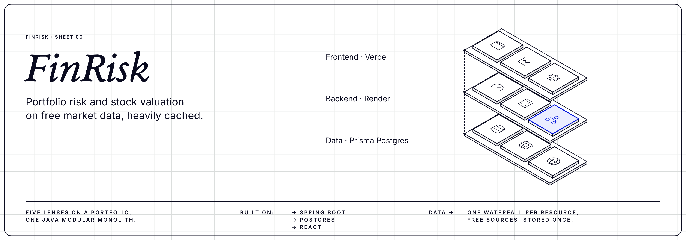
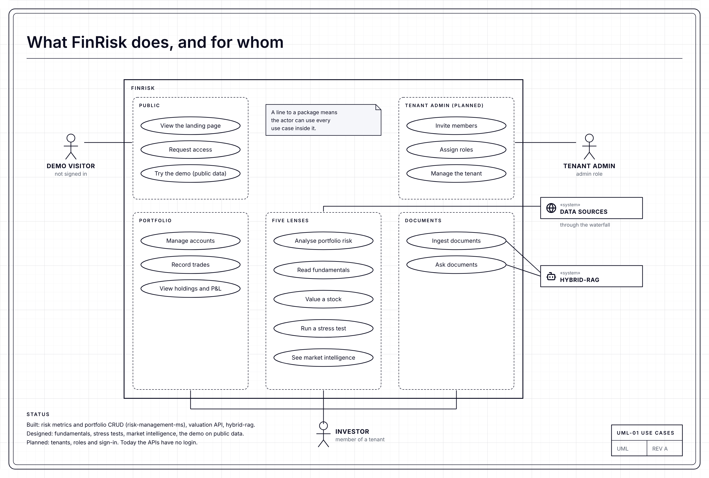
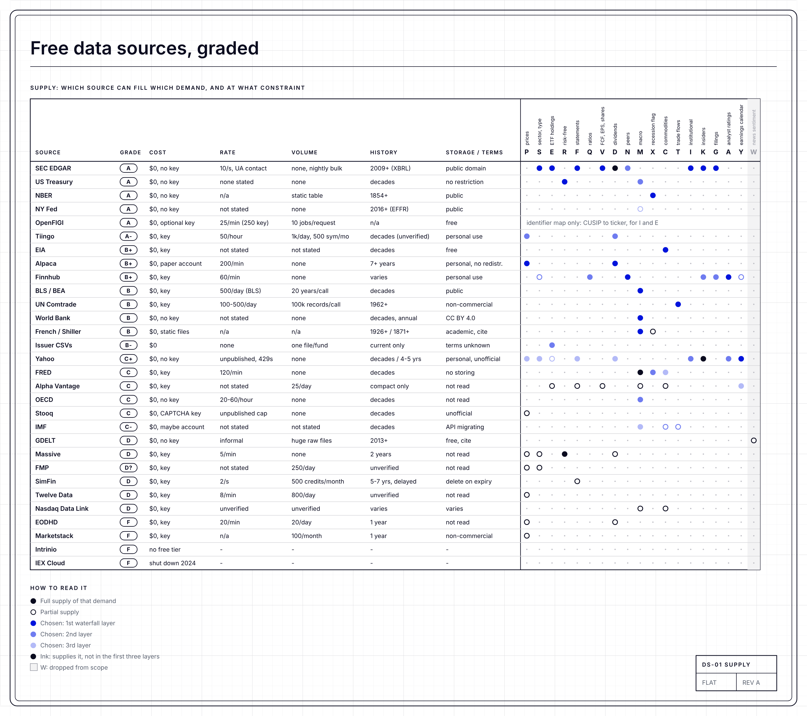
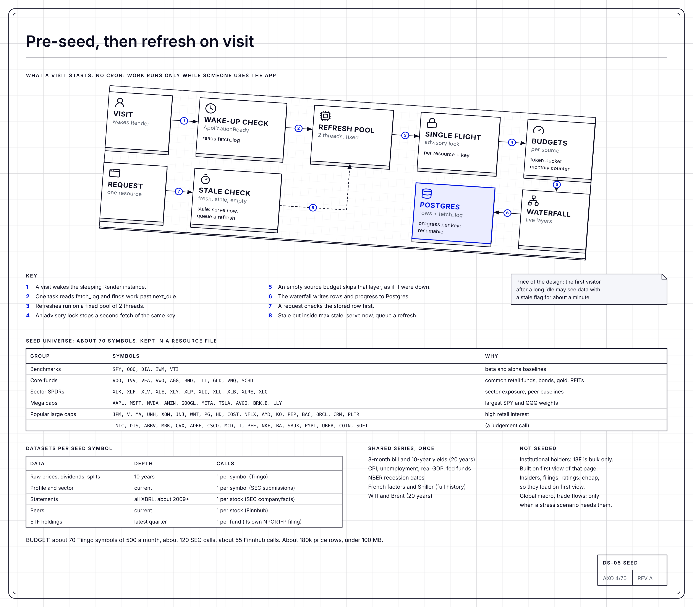
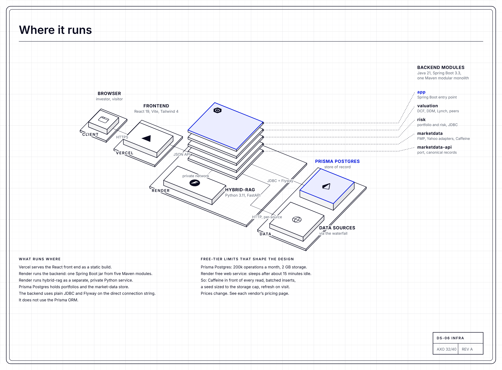

  
  
  
  

  
  
  
  
  
  
  

  
  
  
  

  
  
  
  
  

## About this project

FinRisk helps a private investor understand what they own. You enter your accounts and trades. FinRisk then looks at the portfolio through five lenses: portfolio risk, fundamentals, intrinsic valuation, stress testing and market intelligence. It answers plain questions. How concentrated am I? What do my ETFs really hold? What is this stock worth? What happens to my portfolio in a recession? It gives analysis, not investment advice.

There are three actors. The **investor** is a member of a tenant and owns portfolios. The **tenant admin** invites members and gives them roles. The **demo visitor** is not signed in. The visitor gets a demo on public-domain data. Two outside systems serve them. **Data sources** supply prices, filings and macro series through the waterfall. **hybrid-rag** answers questions about documents that the investor uploads.

The landing page is live at [finance-kit-bay.vercel.app](https://finance-kit-bay.vercel.app/). This screenshot comes from it.

A line to a package means the actor can use every use case in it. The investor reaches three packages through one bus at the bottom.

## What this project focuses on

This is a personal, non-commercial project. It shows how to build a useful finance tool with no budget for data or hosting. Each focus below is a skill the project exercises.

- **Multisource data aggregation.** Twenty-eight free sources were graded on depth, quota and terms. Each data resource gets its own ordered list of sources.
- **Good decisions under budget and compute limits.** Free tiers set hard caps: 25 calls a day, 500 symbols a month, 200k database operations a month. The design treats each cap as a constraint, not as an afterthought.
- **Cache, database and staleness design.** History is stored once and grows by delta fetches. Each resource has a fresh TTL, a revision window and a maximum stale age. Caffeine sits in front of Postgres for hot reads.
- **Shared market data, separate portfolios.** Market data is one shared store. Portfolios are private to a tenant, with role-based access.
- **Decoupling through ports and the waterfall.** Valuation and risk see only the `marketdata-api` port. They cannot see a vendor at compile time. Each resource has its own ordered waterfall of sources.
- **Financial domain knowledge.** DCF, dividend discount and Peter Lynch fair value, peer multiples, beta, alpha, volatility, correlation, drawdown, downside risk, sector exposure and ETF look-through.
- **Front-end visualisation.** The landing app is React 19, Vite and Tailwind 4.
- **Java OOP and CRUD practice.** Layered code, plain JDBC, request validation with `@Valid`, paged and sorted transaction lists, and clear error mapping. Rate limiting per source and per client.
- **Respect for data licences.** Each source has a rights tier. FRED is never stored, because its terms forbid it. Vendor data stays behind a login.

These areas are **not** in scope. They were dropped on purpose, because no free source covers them well, or because other signals already answer the same question:

- **Geopolitical event signals.** The only free feed (GDELT) is noisy and grade D.
- **Analyst price targets and estimates.** Free tiers do not include them. Rating trends stay in scope.
- **Growth estimates.** Same reason as estimates.
- **Company supply-chain links.** No free source was found.
- **News sentiment.** One D-grade source, and its fallback has no sentiment score.

## Data sources

Read the table as a linear program. Each source is a choice: use it or not. Its cost is the free tier, so every row costs $0 or is out. Its constraints are the rate, volume, history and terms columns. Its supply is the dots on the right. A filled dot is full supply of that demand. A ring is partial supply. The goal is to cover every demand with one primary and one fallback, at $0, with the fewest calls and the least risk of breakage.

Heavy caching changes what matters. We pull the full history once and then fetch small daily deltas. So history depth and storage terms matter more than calls per day. The grade sums this up: **A** is official, free, deep and cacheable. **F** is not usable.

The constraints that still bind after caching are in the strip under the table. Tiingo caps the price universe at 500 symbols a month. Alpha Vantage is a slow backfill only. FRED cannot be stored. N-PORT holdings are about 60 days late. The full research, with a tag for how each fact was checked, is in [`docs/data-sources/inventory.md`](docs/data-sources/inventory.md).

## The waterfall

A waterfall tries the sources for one resource in order, until one answers. The order comes from Smith's rule for sequential search. Each try succeeds with chance *p* and costs *c*. Sorting by *p / c*, highest first, gives the lowest expected cost. Here *p* is the grade's reliability times the coverage, and *c* is one plus quota pressure plus a cache penalty. FRED gets a cache penalty of 2, because every FRED read must go live. [`waterfall.py`](docs/data-sources/waterfall.py) computes the order and writes [`waterfall.md`](docs/data-sources/waterfall.md). The order is configuration, so a new score does not need a Java change.

An answer counts only if every required field is present. A required field is checked in the canonical record's constructor. When a layer returns rows without it, the waterfall moves on. One answer comes from one layer. Fields are never mixed across layers, because mixing breaks consistency. A missing optional field stays null, and the domain skips that metric and says so.

The domain sees five ports: `PriceData`, `ReferenceData`, `FundamentalsData`, `MacroData` and `SignalsData`. Each source implements small `*Feed` interfaces, one per resource it can serve. A `Waterfall<F>` holds the ordered layers for one resource. It skips unavailable layers, logs each fall-through and never throws. `WaterfallMarketData` implements all five ports with one waterfall per resource. `CachingMarketData` wraps it.

Several sources speak the same vocabulary, so the overlap is handled once. `UsGaapConcepts` maps us-gaap concept names for SEC and Finnhub. `SectorTaxonomy` maps SIC, Finnhub and Yahoo sectors to one 11-sector list. `IdentifierResolver` maps ticker, CUSIP and CIK through OpenFIGI. `SeriesCatalog` maps a canonical macro ID to each source's own code. The full field mapping per resource is in [`docs/data-sources/contracts.md`](docs/data-sources/contracts.md).

## Caching and storage

Most financial data does not expire. It grows. A closing price for a past day or a filed 10-K does not change. So we keep it and fetch only what is new. Four storage classes cover every resource. **Immutable** rows never change. **Revisable** series get a known trailing window refetched, for example GDP for three years. A **snapshot** is one current value that can change, such as a company profile. **Live only** data is never stored. That is FRED.

Prices need one trick. An adjusted close changes after each later dividend or split. A raw close never changes. So we store the raw close plus the corporate actions, and compute the adjusted close on read. Past price rows then never need a rewrite. When a delta comes from a different layer, we refetch the last stored day. If the two closes differ by more than 0.5 %, the full window reloads from the new layer.

Each resource has three ages. Inside the **fresh TTL** the stored value is served with no call. On a refresh, the **revision window** is refetched. When every live layer fails, the stored value is still served with a warning, up to the **max stale** age. Every response carries `Freshness(asOf, source, stale)`, so the UI can show a small notice.

The rights tier decides what we may keep. Public-domain sources (SEC, Treasury, BLS, BEA, EIA) can be stored and shown. World Bank, OECD, IMF, French and Shiller need a citation. Alpaca, Tiingo, Finnhub, Yahoo and Alpha Vantage are for personal use only, so their data stays behind a login. Each stored row records its `source`, so we can purge one vendor's rows if its terms change.

Postgres is the store of record, in its own `marketdata` schema. History is the asset, and it must survive restarts and redeploys. Delta fetch needs one indexed query for the last date held. Peers and look-through are joins. Caffeine stays in front for hot reads, so most reads never reach the database. We do not use Redis, because Postgres and Caffeine cover both jobs. The details are in [`docs/data-sources/caching.md`](docs/data-sources/caching.md).

## Pre-seed and refresh

On the first boot, a background job stores a seed universe, so the first visitor already sees data. The universe is about 70 symbols in five groups: benchmarks, core funds, sector SPDRs, mega caps and popular large caps. It lives in a resource file, so you can change it without code. For each symbol we store 10 years of raw prices with dividends and splits, the profile and sector, all XBRL statements, peers, and for funds the latest holdings. A few series are stored once for all users: Treasury yields, CPI, unemployment, GDP, fed funds, NBER recessions, French and Shiller factors, and oil prices.

Some data is not seeded. Institutional holders come from 13F bulk files, which are too heavy for a free instance. They are built when a user first opens that view. Insiders, filings and ratings are cheap, so they load on first view. Global macro and trade flows load only when a stress scenario needs them. The whole seed is about 180k price rows, under 100 MB.

There is no cron. Low traffic makes an always-on scheduler a waste, and the Render free instance sleeps when idle. So refresh work runs only while someone uses the app. A visit wakes the instance. One task reads `fetch_log` and refreshes what is past due. A request that finds stale data gets it at once, with the stale flag, and queues a refresh. A Postgres advisory lock stops two fetches of the same key. Each source has a token bucket and a monthly counter, and an empty budget skips that layer. Progress is saved per key, so a job that stops when the instance sleeps continues on the next visit. A fixed pool of two threads keeps refresh work away from request handling.

The price of this design is small. The first visitor after a long idle period may see stale-flagged data for about a minute.

## Infrastructure and stack

The front end runs on **Vercel** as a static React build. The backend runs on **Render** as one Spring Boot jar. It is a Maven modular monolith with five modules. `marketdata-api` is the port and the canonical records. `marketdata` holds the vendor adapters and the cache. `risk` holds the portfolio and risk contexts. `valuation` holds DCF, DDM, Lynch and peer analysis. `app` is the Spring Boot entry point that wires them. Valuation and risk depend only on `marketdata-api`. **hybrid-rag** stays a separate Python FastAPI service, private on Render. It is the only extra service.

The database is **Prisma Postgres**. The backend does not use the Prisma ORM. It uses plain JDBC and Flyway over the direct connection string. The free plan allows 200k database operations a month and 2 GB of storage. Every query counts against that cap, so Caffeine sits in front of every read, inserts are batched and the seed is sized to fit. Prices and plans change, so check [prisma.io/pricing](https://www.prisma.io/pricing) for the current limits.

To set up, run, deploy and call the services on `master`, read the [developer guide](docs/developer-guide.md).
